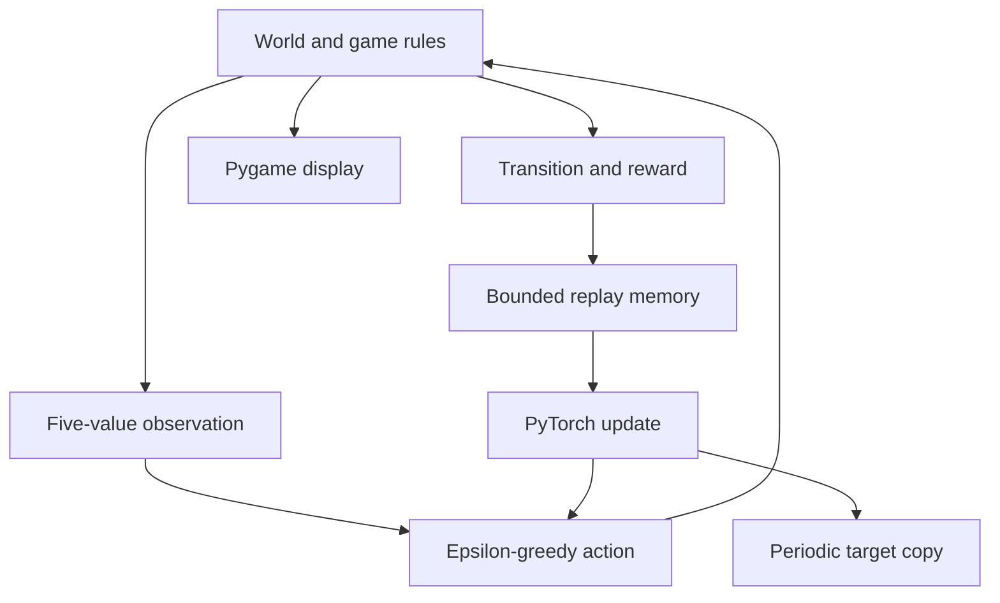

# Architecture and reinforcement-learning contract

Reviewed 14 November 2026 against base commit `3cdc285d2b3f5ce61c61c109bd87e6c65c6b0392`. This is a local learning game, separate from the Thrive & Shine recommendation-design project.

## Runtime boundaries

All boundaries currently live in `ai.py`: `Zombie` and `Bullet` model entities; `AISaviorRL` owns learner/player state; `DQN` and `ReplayBuffer` implement the learner; the top-level loop advances the world and renders. Importing the module initialises Pygame and starts the application. There is no import-safe environment API or packaged executable.

## Observation and actions

The observation is a NumPy `float32` array:

| Index | Value |
| --- | --- |
| 0 / 1 | Player x / 1200 and y / 700 |
| 2 / 3 | Nearest zombie x / 1200 and y / 700; both zero if none remain |
| 4 | Player health / 100 |

Health can exceed 100 because each kill heals five points without a maximum-health rule; that scaled component is not guaranteed to remain within [0, 1]. Other zombies, bullets, level and timers are omitted. This is a partial observation, not evidence of a fully observed Markov state.

Actions 0/1 move up/down four pixels, 2/3 move left/right, and 4 fires at the nearest zombie if one exists. Movement is clipped to the screen. Bullets follow their chosen target's position but may hit another zombie. There is no cooldown or explicit wait action.

## Exact reward produced by the loop

Begin with -100 if health is zero, otherwise -1. Add 0.5 when the player is more than 200 pixels from the screen centre. If zombies remain, add 1.0 when the nearest is more than 300 pixels away, subtract 1.0 when nearer than 100 pixels, and otherwise add nothing. If no zombies remain, add 0.5.

There is **no explicit positive reward per kill** and no direct per-hit health-loss term. Death is penalised; kills also alter health and the world, affecting later rewards. The shaped death reward can differ slightly from -100. A final-wave victory terminates the episode while retaining its ordinary alive/clear-wave reward; it does not receive the death penalty.

## Learner configuration

| Setting in source | Value |
| --- | --- |
| Network | 5 inputs; three 256-unit ReLU hidden layers; 5 Q outputs |
| Optimiser / learning rate | Adam / 0.001 |
| Discount | 0.99 |
| Replay capacity / minibatch | 10,000 transitions / 64 |
| Exploration | Starts at 1.0; multiplied by 0.995 after successful updates; floor 0.1 |
| Loss | Mean squared temporal-difference error |
| Device | CUDA when PyTorch reports it available; otherwise CPU |

Before replay reaches 64 transitions, training returns without parameter or exploration updates. Thereafter it samples a batch, gathers Q-values for taken actions and uses `reward + (1 - done) * 0.99 * max(next_target_Q)` as the target. Gradients update the online network; the target network is not optimised by that loss.

The target starts as a copy of the online network and is copied again when the **pre-increment** update counter is divisible by 100, including the first successful update. Experience replay and target networks are recognised DQN techniques in [Mnih et al. (2015)](https://deepmind-media.storage.googleapis.com/dqn/DQNNaturePaper.pdf). Its Atari results do not validate this game's reward design or policy.

## Episode lifecycle

Each frame selects an action, moves entities, resolves overlaps, applies damage and processes bullets. Rewards are computed from that world. Death or clearing the fifth wave is terminal; its next observation is captured before resetting. The loop records the transition and trains, then resets the trial and spawns level one.

Clearing a lower-level wave continues the same episode. The level advances and the next wave spawns **before** capturing its successor observation, while the reward still describes the wave just cleared. This prevents replay from using an empty old wave as the next state when the next action will see a different world.

Reset clears position, health, bullets, current kills, stationary timer, damage flash and level-banner timing. It updates highest kills/trial count; the caller resets the level number. Networks, optimiser, replay, exploration and update count persist. Waves contain 25, 50, 75, 100 and 300 zombies.

## Design decisions and limits

| Current constraint | Next evidence needed |
| --- | --- |
| Rendering, training and globals share one module | Extract an import-safe environment with explicit reset/step/seed contracts before batch experiments. |
| Pairwise collision separation is quadratic | Profile measured frame/update time before choosing a spatial index. |
| No checkpoint, seed option or evaluation mode | Add versioned experiment inputs, saved policies and no-learning evaluation before reporting improvement. |
| Partial state and hand-designed rewards | Compare simple baselines over held-out seeds; measure survival, return and kills separately. |

Physics and several timers use frame-based units, while banner timing uses elapsed time. Expensive updates can slow wall-clock progress. A 60 FPS cap is not measured sustained throughput. No cloud service, API, multiplayer server, independent rollout workers or distributed training is implemented.
